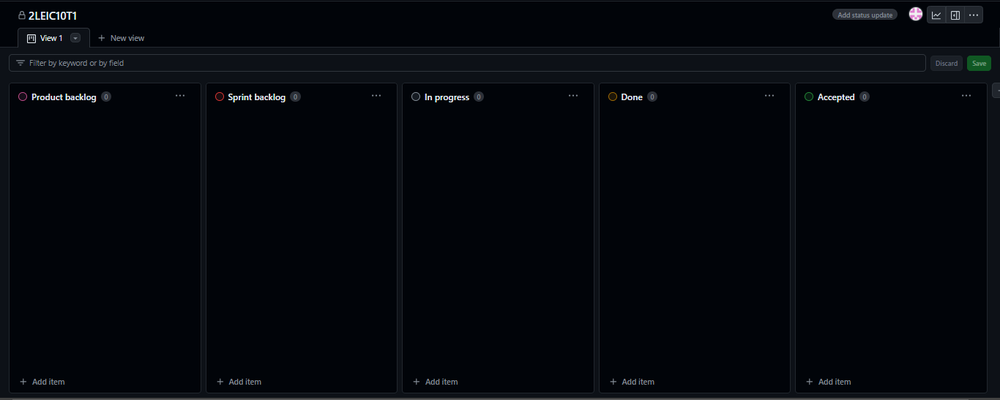
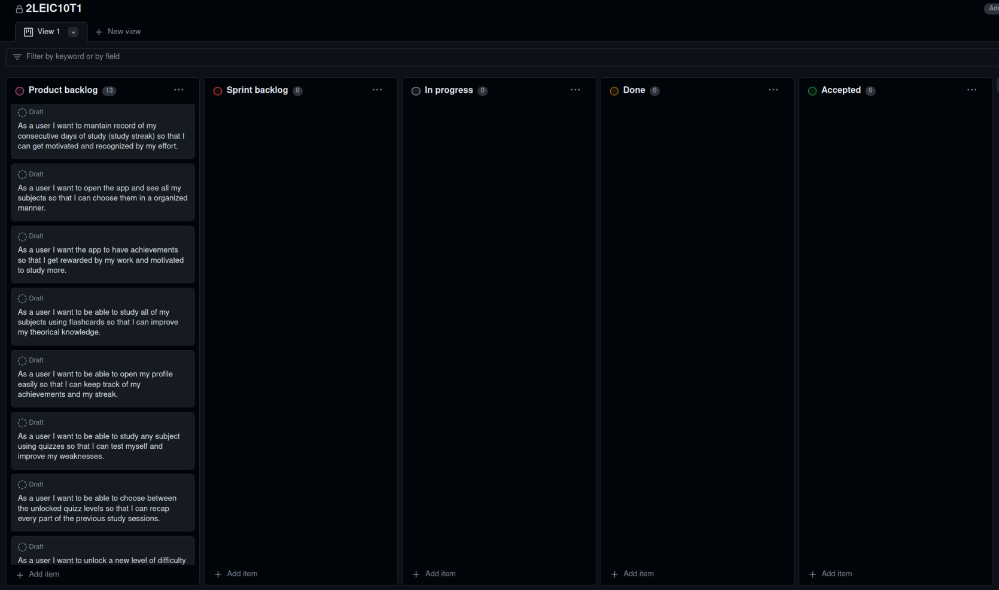

# Iteration 0

## Release
[v0](https://github.com/FEUP-LEIC-ES-2023-24/2LEIC10T1/releases/tag/Primeira_Entrega)

## Project Board

### Beginning of the sprint

### End of the sprint

## Sprint Review

### Teacher Feedback
* Errors in the Domain Model, Logical Architecture and Physical Architecture UMLs.
* UI mockups have some legibility and usability problems (mainly weird buttons and bad color contrast).
* Some acceptance test scenarios could have been more precise.
* Some Product Backlog priorities are questionable.
* Didn't submit .apk on time (only ran in web, not emulator).

## Sprint Retrospective

### What went well?
* Overall, we've worked well with each other, covering the weakness or setbacks of one another.

### What should we do differently?
* Be more careful of what is specifically required of us in the sprint.
