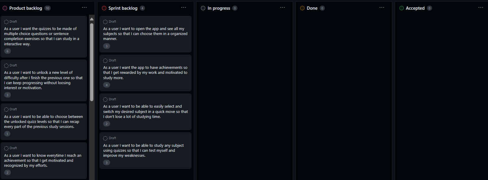
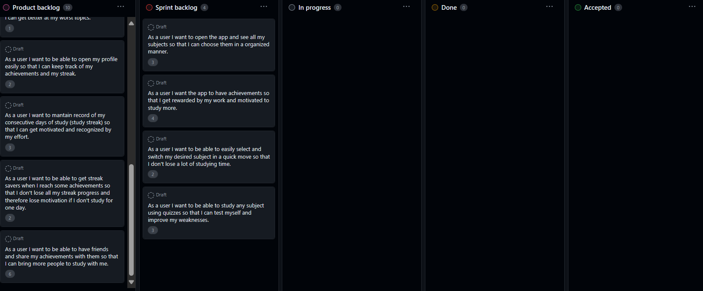
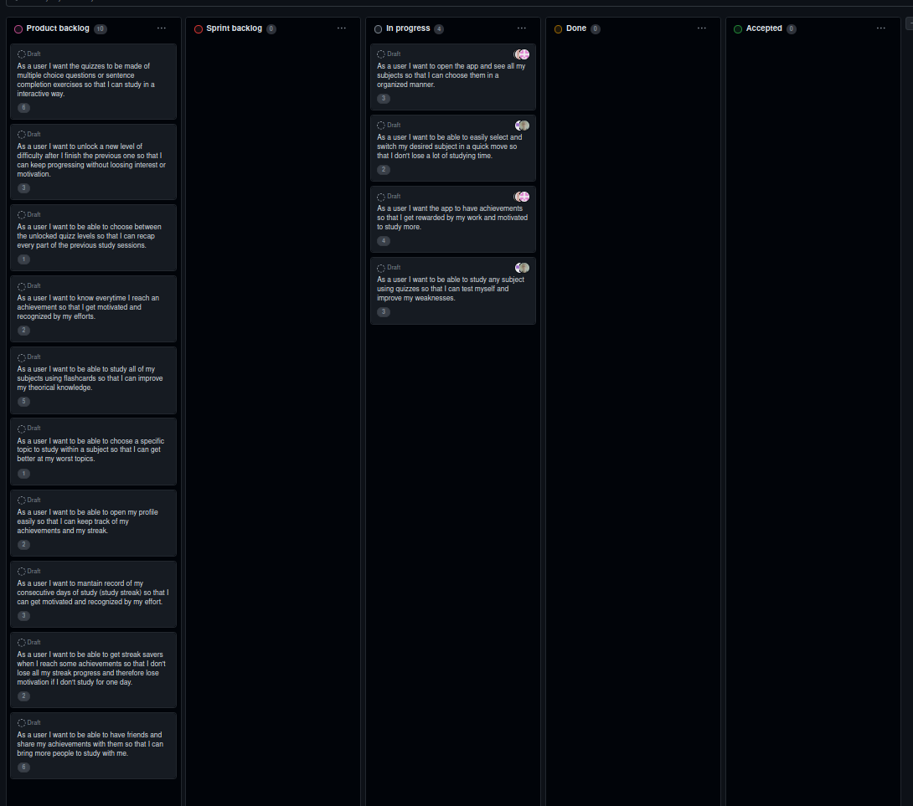

# Iteration 1

## Release
[v1](https://github.com/FEUP-LEIC-ES-2023-24/2LEIC10T1/releases/tag/Segunda_Entrega)

## Project Board

### Beginning of the sprint

### End of the sprint

## Sprint Review

### Teacher Feedback
* Questionable prioritization of PBIs; some user stories depend on others that aren't prioritized correctly.
* Unit tests should test business logic, not UI data display; tests are not running.
* Missing GitHub labels.
* Changelog lacks detail and doesn't effectively support new features; mockups should be in CHANGELOG.md, not README.md.
* App only runs in a web environment, not on an Android device/emulator; UI issues with menu overflow.
* Achievements are listed but not attainable, and cannot test notifications for new achievements; quizzes and flashcards are not functional.

## Sprint Retrospective

### What went well?
* We were able to resolve the problems we had in the previous sprint of linking with and getting Firebase working.

### What didn't go as well?
* We didn't do a good job at organizing the work dynamic.
* We had difficulties at making unit tests.
* Some of our user stories were dependent on each other which made the increment value confusing.

### What should we do differently?
* We need to organize ourselves better and refine our user stories to better understand what each person needs to do.
* We need to better understand how to make good and valuable unit tests.
* We need the increment value to be more tangible to the user, starting from refining and reorganising our user stories.
