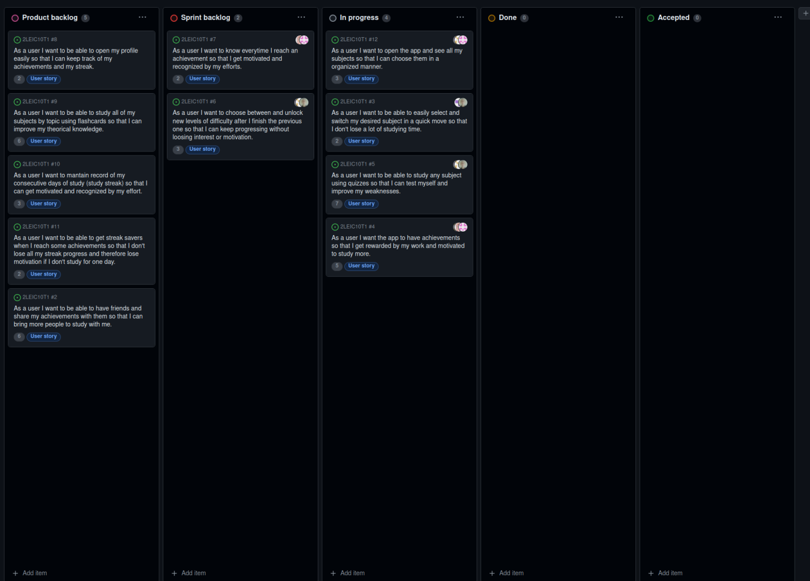
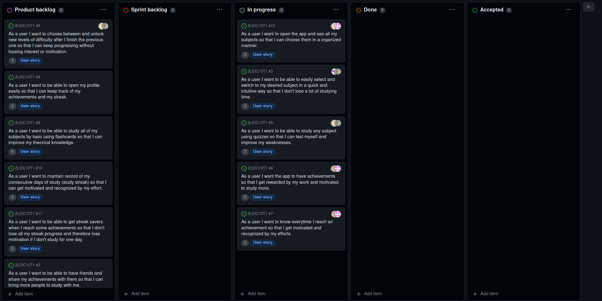
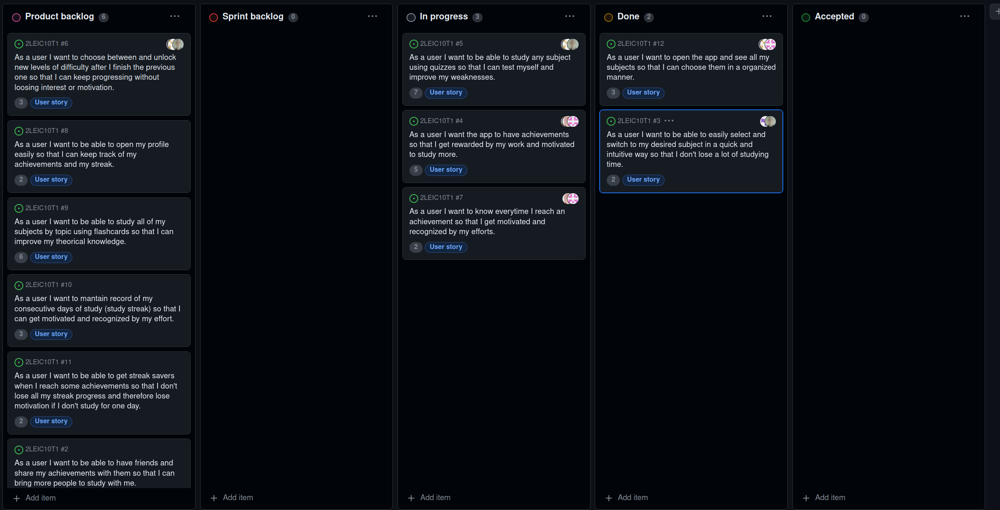

# Iteration 2

## Release
[v2](https://github.com/FEUP-LEIC-ES-2023-24/2LEIC10T1/releases/tag/Terceira_Entrega)

## Project Board

### Beginning of the sprint

### Sprint Refinement

### End of the sprint

## Sprint Review

### Teacher Feedback
* Sprint planning was too optimistic; some work remained unfinished.
* Issues carried over from the previous sprint; some features were not fully implemented, making them less useful to clients.
* Too much hard-coded content; the app is not mature enough for shipping.
* Changelog should focus on features, not app screens, though it has improved since the last sprint.
* Implemented features were expected to be more refined and complete.
* Retrospective needs more verifiable action points and should better address issues like sprint planning accuracy and feature completeness.
* Happiness meters were not filled on time; README needs better organization, with some content moved to separate files.

## Sprint Retrospective

### What went well?
* We worked better as a team, communicating and collaborating well with each-other.
* Even features that were not fully implemented, were able to give us a better understanding and save us work and time for the next iteration.
* We were able to understand better how to unit test (although we still had some trouble) which was one of the biggest problem we had in the previous sprint.

### What didn't go as well?
* We didn't take into account how the exams and activities unrelated to ESOF would affect our time balance when we planned the sprint.

### What should we do differently?
* We need to organize and balance our time better to be more efficient.