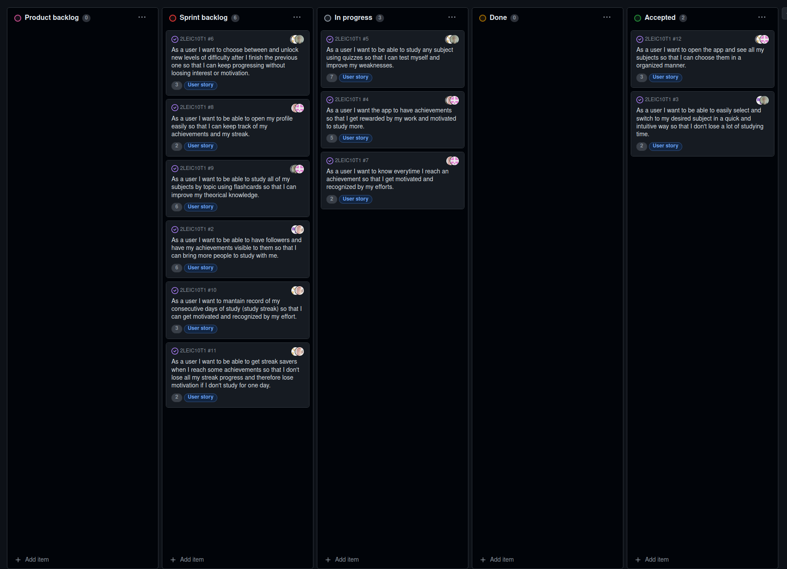
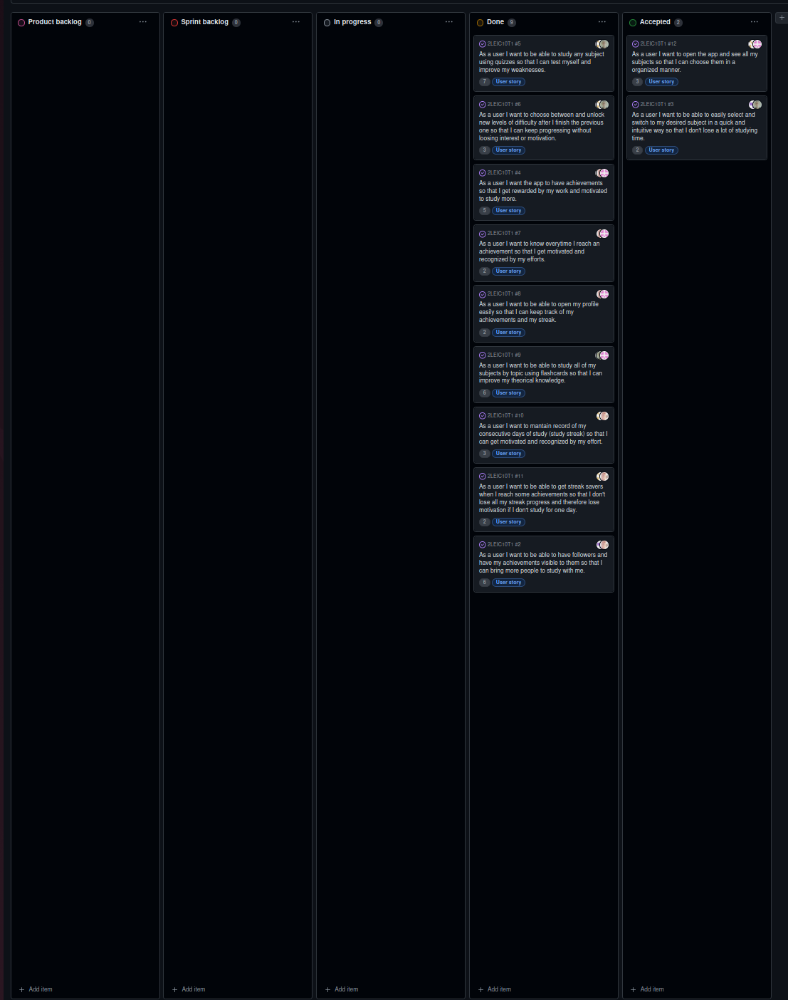

# Iteration 3

## Release
[v3](https://github.com/FEUP-LEIC-ES-2023-24/2LEIC10T1/releases/tag/Entrega_Final)

## Project Board

### Beginning of the sprint

### End of the sprint

## Sprint Review

### Teacher Feedback
* (In the Google Docs the professor provided)

## Sprint Retrospective

### What went well?
* We worked better as a team, communicating and collaborating well with each-other.
* We were able to implement all the remaining features.

### What didn't go as well?
* We couldn't resolve the unit tests problem, finishing features without unit tests.

### What should we do differently?
* We need to search more for help, like asking to Tech Wizards.
